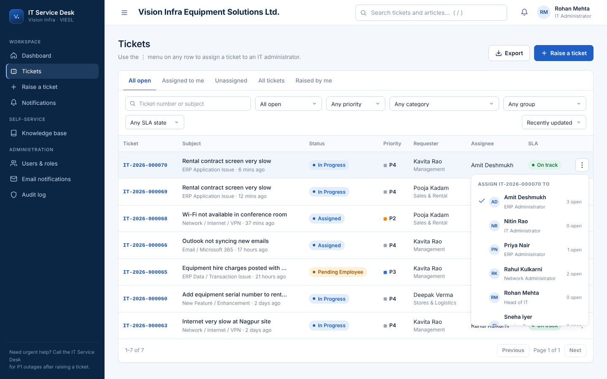

# Vision Infra · IT Service Desk & Smart Ticketing

Internal ITSM portal for **Vision Infra Equipment Solutions Ltd.** — employees raise and track IT tickets
(including detailed ERP issues), IT engineers work queues against business-hours SLAs, leads assign and
escalate, management sees live and historical performance, and every change is audited.

**Stack:** Python · FastAPI · SQLAlchemy 2 · Alembic · PostgreSQL / Microsoft SQL Server (SQLite for local dev) ·
HTML / CSS / vanilla JavaScript (ES modules, no build step) · Docker.



## Quick start (5 minutes, no Docker)
```bash
cd backend
python -m venv .venv && source .venv/bin/activate      # Windows: .venv\Scripts\activate
pip install -r requirements-dev.txt
cp .env.example .env
alembic upgrade head
python -m app.seed --demo
uvicorn app.main:app --reload --port 8000
```
Open **http://localhost:8000** and sign in (password `Vision@Demo2026`, all users fictional):

| Account | Role |
|---|---|
| anjali.sharma@demo.example.com | Employee (Finance) |
| manoj.gupta@demo.example.com | Employee (Procurement) |
| rohan.mehta@demo.example.com | IT Administrator — Head of IT |
| amit.deshmukh@demo.example.com | IT Administrator — ERP |
| rahul.kulkarni@demo.example.com | IT Administrator — Network |
| sneha.iyer@demo.example.com | IT Administrator — Service Desk |

Only two roles exist: **Employee** (raise and track own tickets) and **IT Administrator** (work, assign and
manage everything). Add real users with real company emails under *Users & roles → Add user*.

Tests: `cd backend && python -m pytest` → **120 passed** (auth, two-role matrix, lifecycle, assignment, SLA, email, attachments, exports, audit).
**Free hosting with permanent data:** Vercel + Neon PostgreSQL — step by step in [docs/DEPLOYMENT.md](docs/DEPLOYMENT.md#g-vercel--free-neon-postgresql-permanent-data-no-cost).
Databases supported: SQLite (local), PostgreSQL (Neon / any), Microsoft SQL Server. Tests pass on SQLite and PostgreSQL.

## What works today
- Secure sign-in (Argon2id, short-lived JWT + rotating HttpOnly refresh cookie, lockout, rate limiting)
- Ticket creation with category-specific ERP fields, impact × urgency priority matrix, automatic routing
  (rules engine, round-robin / least-loaded), duplicate detection, KB suggestions, attachments, confirmation
- Full lifecycle with DB-configured transitions, mandatory reasons, resolution vs closure, reopen window, cancel
- Conversation with public replies and private internal notes, complete change history, related/duplicate links, satisfaction rating
- SLA engine on a business calendar (hours, working days, holidays), pauses, no clock resets, warnings, breach escalation, auto-close (never for protected categories)
- Employee home, operations dashboard (live vs period metrics, trend, mix, workload), global search, CSV export
- In-app **and email** notifications that always show the assigned IT administrator; ⋮ menu on every ticket row to assign it
- Attachments limited to images and PDF; users & roles admin (add users), email settings page with test send, audit log, mobile layout

Not yet built (clearly scoped in [docs/ROADMAP.md](docs/ROADMAP.md)): approval workflows, KB authoring, suggestions portal, assets/CMDB, admin UIs for SLA/categories/rules, SSO.

## Documentation
| Doc | Contents |
|---|---|
| [ARCHITECTURE](docs/ARCHITECTURE.md) | Overview, modules, ER diagram, folder structure, decisions, assumptions, phases |
| [PERMISSIONS](docs/PERMISSIONS.md) | Role-permission matrix and tested role × action matrix |
| [API](docs/API.md) | Conventions, error format, all endpoints (`openapi.json` included) |
| [DEPLOYMENT](docs/DEPLOYMENT.md) | Dev setup, Docker + SQL Server, production, backup/restore, troubleshooting |
| [SECURITY](docs/SECURITY.md) | Security checklist |
| [ROADMAP](docs/ROADMAP.md) | Known limitations, improvements added, roadmap |
| `docs/sqlserver_schema.sql` | SQL Server DDL generated from the migration (for DBA review) |
