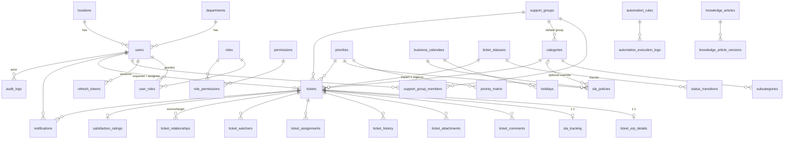

# Architecture — Vision Infra IT Service Desk

## 1. Overview

```
 Browser (HTML/CSS/vanilla JS ES modules, no build step)
    │  same origin, strict CSP, access token in memory, refresh token = HttpOnly cookie
    ▼
 FastAPI app (Python 3.12+)  ── /api/v1 REST ── OpenAPI
    ├─ api/v1/*        thin routers: validate input (Pydantic), call services, shape output
    ├─ services/*      ALL business rules: lifecycle, SLA, routing, notifications, access, audit
    ├─ models/*        SQLAlchemy 2 ORM, SQL Server-compatible types (NVARCHAR, DATETIME2, BIT)
    ├─ core/*          config, DB engine, security (Argon2id, JWT), errors, rate limiting
    └─ scheduler       in-process background loop: SLA warnings/breaches, escalation, auto-close, email outbox
    ▼
 Microsoft SQL Server (production)  ·  SQLite (local development & tests only)
 Attachments on disk/volume outside the web root, served only through an authorised endpoint.
```

**Stack decision (documented deviation).** The brief recommended React + TypeScript + Vite. You asked for
HTML, CSS, JavaScript and Python, so the frontend is plain ES modules with no build toolchain:
it runs on any intranet server, needs no Node.js in production, and keeps a strict CSP. Charts are
small hand-written SVG components (no CDN). The backend follows the recommended stack exactly
(FastAPI, Pydantic, SQLAlchemy, Alembic, SQL Server).

## 2. Major modules

| Module | Status in this release |
|---|---|
| Authentication (local, Argon2id, JWT 15 min + rotating refresh token, lockout, rate limit) | **Done** |
| RBAC with server-side permission checks + row-level ticket visibility | **Done** |
| Ticket creation (ERP fields, impact×urgency priority, routing, duplicate detection, KB suggestions, idempotency) | **Done** |
| Lifecycle (13 configurable statuses, DB-defined transitions, reasons, history, resolve/close/reopen/cancel) | **Done** |
| Assignment (manual, accept, escalation, round-robin / least-loaded auto-assignment, rules engine + log) | **Done** |
| SLA engine (business calendar, holidays, pauses, no clock reset, warnings, breach escalation) | **Done** |
| Comments & internal notes, attachments (magic-byte validation), related/duplicate links, CSAT rating | **Done** |
| Dashboards (employee + operations, live vs historical, filters), global search, CSV export | **Done** |
| In-app + email notifications (HTML emails, sent instantly, retried on failure, test-send page) | **Done** (tested against a local SMTP server, not yet against the company relay) |
| Knowledge base (search, read, suggestions while raising tickets) | **Read side done**; authoring/review UI is Phase 5 |
| Users & roles admin, audit log viewer | **Done** |
| Approval workflows, suggestions portal, assets/CMDB, admin UI for categories/SLA/calendars/rules | **Planned** (Phases 5–6); tables for rules/SLA/calendars exist and are seeded |

## 3. Database ER diagram (implemented tables)



Key relationships and decisions
- **Ticket numbers** `IT-YYYY-NNNNNN` come from `ticket_sequences` (one row per year, updated under a row lock), so numbers are gap-free per year and safe under concurrency.
- **ERP details** live in `ticket_erp_details` (1:1) — hardware/general tickets never carry irrelevant ERP columns.
- **SLA state** lives in `sla_tracking` (1:1) and snapshots the targets used, so later policy edits do not rewrite history.
- **Statuses and transitions are data** (`ticket_statuses`, `status_transitions` with `actor` = staff/requester/any and `requires_reason`), enforced in `services/tickets.py`.
- **History is append-only** (`ticket_history`: field, old, new, actor, reason, internal flag, timestamp). Resolution time (`resolved_at`) and closure time (`closed_at`) are tracked separately.
- **Optimistic locking** via `tickets.version` (SQLAlchemy `version_id_col`).
- **SQL Server specifics:** `NVARCHAR(MAX)` for long text (no deprecated `NTEXT`), `DATETIME2(3)` UTC, `BIT` booleans, named constraints, no cascading deletes (avoids multiple-cascade-path errors), no unique constraints on nullable columns. `docs/sqlserver_schema.sql` is the DDL generated offline by Alembic for the SQL Server dialect.
- **Timestamps** are stored in UTC and returned with offset; the UI renders them in the user's `timezone` (default Asia/Kolkata).

Planned tables (Phases 5–6): `approval_workflows`, `approval_stages`, `approval_requests`, `approval_decisions`, `suggestions`, `it_assets`, `configuration_items`, `asset_assignments`.

## 4. Folder structure

```
vision-servicedesk/
├─ backend/
│  ├─ app/
│  │  ├─ main.py                 app factory, middleware (request id, security headers, rate limit), static frontend
│  │  ├─ seed.py                 reference data + optional demo data
│  │  ├─ core/                   config, database, security, errors, rate_limit
│  │  ├─ models/                 base (UTC type, LongText), identity, catalog, ticket, platform
│  │  ├─ schemas/                Pydantic request/response models (extra="forbid" on inputs)
│  │  ├─ services/               tickets, sla, business_time, routing, access, notifications,
│  │  │                          scheduler, dashboard, attachments, audit, settings_service
│  │  └─ api/  deps.py · v1/{auth,tickets,meta,dashboard,platform}.py
│  ├─ alembic/                   migrations (0001_initial_schema)
│  ├─ tests/                     120 tests incl. role × action matrix
│  ├─ Dockerfile · requirements*.txt · pytest.ini · .env.example
├─ frontend/
│  ├─ index.html · css/app.css · assets/favicon.svg
│  └─ js/ app.js (shell, router) · api.js · ui.js · state.js · charts.js · pages/*.js
├─ deploy/ sql/init.sql · nginx/servicedesk.conf
├─ docs/  ARCHITECTURE · PERMISSIONS · API · DEPLOYMENT · SECURITY · ROADMAP · openapi.json · sqlserver_schema.sql
└─ docker-compose.yml · .env.docker.example
```

## 5. Important security & operational decisions
- Permissions are checked on the server for every endpoint (`require(...)` dependencies) **and** every ticket query is filtered by `ticket_visibility_clause()`; the UI only hides buttons as a convenience.
- Requester, department and location are taken from the authenticated user — never from the request body.
- Internal notes, internal attachments, internal history entries and root cause are filtered out for non-staff at the query level, including in related-ticket lists, search and exports.
- Priority changes re-target the SLA from the **original** start time; status changes only pause/resume. Nobody can reset the clock.
- Protected categories (Security Incident, Employee Exit) are never auto-closed.
- Background jobs are idempotent (dedupe keys, flags) so overlapping runs or restarts cannot double-notify.
- Email is queued but delivered only when `EMAIL_ENABLED=true` and SMTP is configured; until then a log provider is used.

## 6. Assumptions made
1. Working calendar: Monday–Saturday, 09:30–18:30 IST; only fixed national holidays are seeded — add company/state holidays.
2. SLA targets (business minutes): P1 30/240, P2 60/540, P3 240/1620, P4 480/2700; Security P1 15/180. These are examples to be confirmed by IT management.
3. New tickets start in **Submitted**; **New** is reserved for future email-to-ticket intake.
4. Pauses: Pending Employee, Pending Approval, Resolved, Closed, Cancelled pause the SLA. Pending Vendor / Pending Change do **not** pause by default (configurable in `ticket_statuses.pauses_sla`).
5. Two roles only: Employee and IT Administrator. IT administrators belong to support teams (ERP, Infrastructure, End-User Computing, Service Desk, Security) used for automatic routing; any administrator can assign any ticket.
6. Reopen window 7 days; auto-close 5 days after resolution with a reminder at day 3.
7. Local accounts are used now; SSO (Azure AD / Entra ID via OIDC) is a planned enhancement — `users.auth_provider` already exists.

## 7. Phased plan
| Phase | Scope | Status |
|---|---|---|
| 1 | Requirements, architecture, permissions, ERD, structure | Done (this document) |
| 2 | Auth, users, departments, RBAC, migrations, audit | Done |
| 3 | Ticket create/list/detail, comments, assignment, lifecycle, history | Done |
| 4 | Dashboards, priority engine, SLA monitoring, escalations | Done |
| 5 | Approval workflows, KB authoring & review, suggestions portal, email go-live | Next |
| 6 | Assets & CMDB, Excel exports & report builder, admin UIs for rules/SLA/calendars | Planned |
| 7 | SSO, Redis-backed rate limit, load testing, pen-test fixes, HA deployment | Planned |
